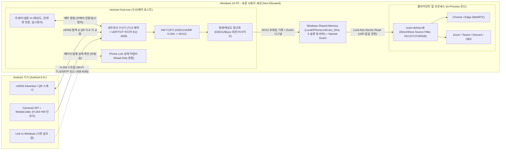

# Windows 10용 Phone Link 연동 가상 웹캠 브리지 구현 계획서

> [!IMPORTANT]
> 본 계획서는 Windows 10 환경에서 Android 스마트폰 카메라를 PC 웹캠으로 활용하기 위한 실용적 구현 설계입니다. Microsoft의 **Phone Link(휴대폰과 연결)** 네이티브 카메라 기능은 Windows 11 전용 OS API와 시스템 컴포넌트에 강하게 결합되어 있어 바이너리 후킹이나 이식이 불가능하므로, **Phone Link를 비침습적 상태/트리거 어댑터로만 활용하고 독립 로컬 스트리밍 브리지 + Windows 10 사용자 모드 DirectShow 가상 웹캠**을 결합하는 아키텍처를 채택합니다.

---

## 1. 배경 및 목표

### 1.1 Windows 11 vs Windows 10 기술적 차이 (로컬 환경 실측 포함)
Windows 11(22H2/23H2, 빌드 `22621`/`22631`+)에서는 Android `Link to Windows` (`1.24012`+)와 Windows의 `Cross Device Experience Host`가 결합하여 스마트폰을 표준 웹캠으로 노출합니다. 반면 대상 환경인 Windows 10(`Microsoft Windows 10 Home 10.0.19045`, 64-bit)을 직접 점검한 결과, 다음과 같은 구조적 차이가 확인되었습니다.

| 구분 | Windows 11 (네이티브 지원) | Windows 10 (`10.0.19045` 실측) |
| :--- | :--- | :--- |
| **가상 카메라 OS API** | `MFCreateVirtualCamera` (`mfvirtualcamera.h`, `mfsensorgroup.dll`, `IMFVirtualCamera`) 지원 (Build `22000`+) | `C:\Windows\System32\mfsensorgroup.dll` (`10.0.19041.7844`) 내 32개 Export 중 **`MFCreateVirtualCamera` 부재** |
| **Cross Device Experience Host (`MicrosoftWindows.CrossDevice`)** | 전체 서비스(`CrossDeviceService.exe`, `CrossDevice.dll`) 배포 및 설정(`Bluetooth & devices > Mobile devices`) 연동 | `0.25072.59.0_x64__cw5n1h2txyewy` 패키지가 존재하나 **스텁(`CrossDeviceComponentStub.dll`, `CrossDeviceSettingsHost.exe`) 전용** (`CrossDeviceService.exe`/`CrossDevice.dll` 부재) |
| **Phone Link (`Microsoft.YourPhone`)** | `PhoneExperienceHost.exe` + CDEH 연동을 통한 Connected Camera 제공 | `1.25072.81.0_x64__8wekyb3d8bbwe` 설치됨. 화면 미러링(`YourPhone.ScreenMirroring.*.dll`)·오디오(`YourPhone.Audio.dll`)·프로젝션 DLL은 있으나 **가상 카메라 호스트 없음** |
| **카메라 파이프라인** | Media Foundation + Windows Camera Frame Server 통합 (Win32 + UWP 모두 인식) | 사용자 모드에서 Frame Server에 직접 가상 카메라 등록 불가 (Kernel AVStream 드라이버 없이는 DirectShow 필터만 가능) |

### 1.2 핵심 제약 요약 및 프로젝트 목표
1. **OS API 부재**: Windows 10에는 `MFCreateVirtualCamera`가 없으며, `SwDeviceCreate` + `IMFMediaSource` 조합 역시 커널 모드 AVStream 드라이버 없이는 Windows 10에서 활성화 계약을 충족할 수 없습니다.
2. **비공개 프로토콜 및 Store 게이팅**: `Link to Windows` ↔ `CrossDeviceService.exe` 간 통신은 비공개 프로토콜(CDP + Azure SignalR/Microsoft DCG 클라우드 릴레이 + 로컬 P2P Wi-Fi)이며, `Microsoft.YourPhone`은 Microsoft 전용 `CustomCapability`(`Microsoft.coreAppActivation_8wekyb3d8bbwe`, `Microsoft.unsignedPackageManagement_8wekyb3d8bbwe`) 및 Store 업데이트 게이팅에 묶여 있습니다.
3. **목표**:
   - Windows 10(64-bit, `19045` 등)에서 **커널 드라이버/EV 코드 서명 없이** 즉시 배포 가능한 저지연(`≤ 80–120 ms`) Android-to-PC 가상 웹캠 브리지 구현.
   - Chrome/Edge WebRTC, Zoom, Discord, OBS Studio 등 주요 데스크톱/브라우저 화상회의 앱 호환 확보 (단, MSIX 샌드박스 기반 New Teams는 실행 순서·권한 환경에 따라 DirectShow 열거 제약이 있을 수 있어 Teams Web 폴백 병행).
   - 기존 Phone Link 사용자 경험을 해치지 않으면서, 연결 상태/기기 정보를 보조적으로 연동하고 향후 Windows 11(`MFCreateVirtualCamera`) 또는 서명된 AVStream 드라이버로 확장 가능한 모듈형 구조 설계.

---

## 2. 아키텍처 대안 비교 및 선정

### 2.1 전송 및 Phone Link 연동 대안 비교

| 평가 항목 | Option A: Phone Link 바이너리 후킹 / 프로토콜 역공학 / Win11 CDEH 이식 | Option B: Phone Link 상태/트리거 어댑터 + 독립 로컬 스트리밍 브리지 (권장) |
| :--- | :--- | :--- |
| **구현 메커니즘** | `PhoneExperienceHost.exe` 또는 `Link to Windows` APK 역공학, CDP/DCG/WebRTC 시그널링 가로채기, Win11 `CrossDeviceService.exe` 이식 | 경량 Android 컴패니언 앱이 Camera2/MediaCodec으로 캡처·인코딩 후 로컬 Wi-Fi(TLS) 또는 USB(ADB)로 PC에 직접 스트리밍. Phone Link는 설치·실행 상태 확인 및 보조 트리거로만 사용 |
| **기술적 실현 가능성** | **불가(매우 낮음)**: Win10 커널/시스템 DLL에 `MFCreateVirtualCamera`가 없어 이식된 `CrossDeviceService.exe`도 카메라 등록 실패. AppContainer 및 서명된 `CustomCapability` 우회 불가 | **높음**: 검증된 표준 기술(Android Camera2 + MediaCodec H.264, mDNS/TLS/WebRTC 또는 SRTP, ADB 포트 포워딩)만 사용 |
| **유지보수성** | Microsoft Store 자동 업데이트 시마다 오프셋/프로토콜 변경으로 즉시 파손 | 자체 제어 가능한 버전 관리 프로토콜(Protobuf/JSON 제어 + H.264 미디어 스트림)로 안정적 유지보수 |
| **서명 및 ToS/보안 리스크** | Microsoft 소프트웨어 리버스 엔지니어링/변조에 따른 **ToS 위반**, 시스템 보안 무결성 훼손, 백신(Defender) 탐지 확실 | 표준 사용자 모드 애플리케이션 + 오픈/자체 인증 TLS 통신으로 ToS 충돌 및 보안 리스크 없음 |

### 2.2 Windows 10 가상 웹캠 구현 티어 비교

| 구현 방식 | 작동 메커니즘 | 앱 호환성 (Win10) | 드라이버 서명 및 구현 비용 |
| :--- | :--- | :--- | :--- |
| **DirectShow Source Filter (MVP 권장)** | 사용자 모드 C++ COM DLL(`CLSID_VideoInputDeviceCategory`, `{860BB310-5D01-11d0-BD3B-00A0C911CE86}`) 등록 (`regsvr32`, x64 기본/x86 선택) | **지원**: Chrome/Edge WebRTC(`video_capture_device_factory_win.cc`), Zoom, Discord, OBS, New Teams(MSIX 샌드박스 조건부; Teams Web 폴백).<br>**미지원**: UWP/Store 앱(Windows Camera 앱), Win10 설정 > 카메라, `FrameServer.dll` | **커널 드라이버/EV 서명 불필요**. 순수 C++ COM DLL로 구현·배포 용이 |
| **Kernel-Mode AVStream Minidriver** | `ks.sys` 기반 WDM 드라이버(`KSCATEGORY_VIDEO_CAMERA`, `{E5323777-F976-4f5b-9B55-B94699C46E44}`) | **전체 지원**: Win32/브라우저 + UWP/Store 앱 + `FrameServer.dll` 멀티플렉싱 | **매우 높음**: Ring-0 BSOD 위험 + **EV 코드 서명 인증서 + Microsoft Partner Center Attestation Signing 필수** (Azure Trusted Signing 대체 불가) |
| **UMDF 2.0 / `SwDeviceCreate` + `IMFMediaSource`** | 커널 드라이버 없이 사용자 모드 Media Foundation 장치 노출 시도 | **Win10 불가**: Device MFT는 기존 AVStream 드라이버 상단에만 동작하며, 드라이버리스 가상 카메라는 Win11 `MFCreateVirtualCamera` 필요 | 해당 없음 (Win10 미지원) |

### 2.3 최종 선정안
- **Option B + DirectShow Source Filter(x64 우선, 필요 시 x86 병행)**를 MVP 아키텍처로 선정합니다.
- **명확한 범위 제한(Scope Cut)**:
  1. **UWP Windows Camera 앱 미지원 수용**: 화상회의 및 브라우저 앱이 핵심 사용처이므로, MVP에서는 EV 서명 장벽을 피하기 위해 UWP 앱 지원을 범위에서 제외합니다.
  2. **가상 마이크(오디오) MVP 제외**: Windows 10에서 새 마이크 엔드포인트를 생성하려면 WDK `SysVAD` 기반 커널 WDM 오디오 드라이버와 EV+Partner Center 서명이 필수이므로(사용자 모드 APO로는 생성 불가), MVP는 **비디오 전용**으로 한정합니다.
  3. **백엔드 교체 가능성 확보**: 수신기(Receiver)와 가상 카메라 필터 간 통신을 공유 메모리 추상화 계층(`IVirtualCameraSink` 개념)으로 분리하여, 추후 EV 서명 확보 시 AVStream 드라이버로, 또는 OS가 Windows 11로 업그레이드될 경우 `MFCreateVirtualCamera` 백엔드로 코드 재작성 없이 교체할 수 있게 설계합니다.

---

## 3. 전체 시스템 아키텍처

### 3.1 컴포넌트 및 프로세스 경계 다이어그램



### 3.2 프로세스 경계 및 UIPI 고려사항
- **권한 일치 원칙 (UIPI Parity)**: Windows 10의 브라우저(Chrome/Edge), Zoom, Teams, Discord는 모두 일반 사용자(Medium/Low Integrity) 권한으로 실행됩니다. `receiver-host.exe`가 관리자 권한(Elevated)으로 실행되면 `Local\` 네임스페이스 및 Win32 Named Event 접근 시 UIPI/ACL 충돌이 발생하므로, **수신 호스트와 트레이 UI는 반드시 표준 사용자 세션에서 비승격(Non-Elevated) 상태로 실행**합니다.
- **In-Process 격리**: `vcam-dshow.dll`은 클라이언트 앱 프로세스 내부에 COM DLL로 로드되므로 크래시 시 호스트 앱(Zoom/Chrome 등)이 함께 종료됩니다. 따라서 필터 DLL 내부에는 네트워크·디코딩 로직을 전혀 두지 않고, **공유 메모리에서 완성된 프레임을 읽어 DirectShow 핀으로 전달하는 최소 역할**만 수행합니다.

### 3.3 IPC 및 공유 메모리 구조 (`Local\PhoneLinkCam_Shm`)
- **매핑 방식**: `CreateFileMappingW` / `MapViewOfFile` (`Local\` 세션 접두사 사용, 다중 Windows 사용자 세션 격리).
- **3-슬롯 트리플 링 버퍼**: 쓰기(Receiver)와 읽기(다수 클라이언트 앱)가 잠금(Mutex) 없이 경합하지 않도록 3개 프레임 슬롯을 순환합니다.
  - 최대 지원 기준(`1920×1080 NV12`, 프레임당 `3,110,400 bytes ≈ 3.11 MB`) 기준, 헤더 포함 **총 약 `~10 MB` 고정 할당**.
- **공유 메모리 헤더 레이아웃 (64바이트 캐시라인 정렬)**:
  - `magic` (`uint32`), `version` (`uint32`)
  - `write_seq` (`atomic uint64`, 짝수=쓰기 완료 / 홀수=갱신 중 또는 슬롯 인덱스 분리)
  - `active_slot` (`atomic uint32`, `0..2`), `frame_state` (`LIVE` | `PAUSED` | `DISCONNECTED`)
  - `width`, `height`, `stride`, `pixel_format` (`NV12` / `YUY2`), `timestamp_100ns` (`int64`, 단조 증가 QPC 기반)
- **동기화**: 프레임 쓰기 완료 시 `write_seq`를 원자적으로 증가시킨 뒤 이벤트를 시그널합니다. 다중 DirectShow 클라이언트가 동시에 읽을 때 Auto-Reset `Named Event`는 대기 스레드 1개만 깨우므로, **Manual-Reset 펄스 또는 각 필터 핀(Pin)별 33ms(`30 fps`) 페이싱 타이머 + `write_seq` 변경 확인** 방식으로 다중 소비자 경합을 방지합니다. 타임아웃/미갱신 시 마지막 유효 프레임 또는 대기(Standby) 프레임을 반환하여 클라이언트 타임아웃(`NotReadableError`)을 차단합니다.

### 3.4 보안 및 페어링 설계
1. **클라우드 미경유 원칙**: 모든 영상 스트림과 제어 신호는 **로컬 Wi-Fi(동일 서브넷) 또는 USB(ADB)** 내부로 제한합니다. Microsoft DCG 클라우드나 외부 릴레이 서버를 거치지 않습니다.
2. **디스커버리 및 페어링**:
   - PC 호스트가 mDNS(`_phonelinkcam._tcp.local.`)로 서비스 브로드캐스트 + 로컬 IP/포트/일회성 세션 토큰/ECDSA P-256 공개키 지문(Fingerprint)을 **QR 코드**로 표시.
   - Android 앱이 QR 스캔 시 PC 공개키를 핀닝(Pinning)하고, 자체 클라이언트 인증서를 교환하여 **TLS 1.3 상호 인증(mTLS)** 채널 수립.
3. **데이터 평면 암호화**: 제어 채널은 TLS 1.3 TCP 소켓, 미디어 채널은 동일 세션 키를 파생한 **SRTP(또는 DTLS-SRTP / TLS-TCP 저지연 모드)**를 사용하여 동일 Wi-Fi 망 내 스니핑을 차단합니다.
4. **프라이버시 보호**: 트레이 UI 및 Android 측에 즉시 검은 화면/대기 화면으로 전환하는 **일시정지(Privacy Pause)** 스위치를 제공하고, 스트리밍 활성 중 Android 포그라운드 서비스 알림(시스템 카메라 인디케이터 포함)을 상시 표시합니다.

### 3.5 대상 프로젝트 경로 및 저장소 레이아웃
본 구현 계획서의 정본(Canonical) 위치와 실제 소스 코드가 배치될 저장소 루트는 `D:\programming language\pythun\Github\Win10-PhoneLink-WebCam`입니다. PC 네이티브 모듈(`pc/`), Android 컴패니언 앱(`android/`), 설치 패키징(`installer/`)을 경계에 맞게 분리합니다.

```text
D:\programming language\pythun\Github\Win10-PhoneLink-WebCam\
├── IMPLEMENTATION_PLAN.md          # 구현 계획서 정본
├── README.md                       # 빌드·설치 가이드 및 Win10 지원 범위 안내
├── docs/                           # 제어 프로토콜 스키마(TLS/QR) 및 테스트 체크리스트
├── pc/                             # Windows 10 PC 컴포넌트 (CMake / Visual Studio)
│   ├── CMakeLists.txt
│   ├── shared/                     # 공유 메모리 헤더(Local\PhoneLinkCam_Shm) 및 싱크 인터페이스
│   ├── vcam-dshow/                 # DirectShow Source Filter COM DLL (x64/x86)
│   ├── receiver-host/              # TLS/ADB 수신기, D3D11VA/MF H.264 디코더, 회전 정규화
│   ├── phonelink-adapter/          # Phone Link(Microsoft.YourPhone) 읽기 전용 상태 어댑터
│   ├── tray-ui/                    # 시스템 트레이 및 QR 페어링 설정 UI
│   └── tests/                      # SHM 링 버퍼·타임스탬프 단위 테스트 및 WebRTC 검증 스크립트
├── android/                        # Android 컴패니언 앱 (Kotlin / Gradle)
│   ├── app/                        # Camera2 + MediaCodec H.264, mDNS/QR/TLS 송신 모듈
│   └── build.gradle.kts
└── installer/                      # Inno Setup / WiX 인스톨러 (regsvr32 및 방화벽 규칙 등록)
```

---

## 4. 핵심 모듈 상세 설계

### 4.1 가상 웹캠 필터 (`vcam-dshow.dll`)
- **컴포넌트 형태**: C++20 COM DLL (`x64` 필수, 레지스트리 등록 시 레거시 32비트 앱 대응이 필요한 경우 `x86` 동일 빌드 및 등록).
- **등록 경로**: `DllRegisterServer` / `DllUnregisterServer`에서 `IFilterMapper2`를 통해 `CLSID_VideoInputDeviceCategory` (`{860BB310-5D01-11d0-BD3B-00A0C911CE86}`)에 친숙한 이름(예: `"Phone Link Virtual Camera (Win10)"`)으로 등록.
- **지원 미디어 타입 (`EnumMediaTypes` 협상 우선순위)**:
  1. `MEDIASUBTYPE_NV12` (4:2:0, 12 bpp, `VIDEOINFOHEADER2` / `VIDEOINFOHEADER`): Chromium WebRTC/Teams/Zoom 하드웨어 인코더가 직접 소비하며, PC HW 디코더 출력과 일치해 **색상 변환 비용 0**.
  2. `MEDIASUBTYPE_YUY2` (4:2:2, 16 bpp): 구형 DirectShow 클라이언트 폴백 (`libyuv::NV12ToYUY2`).
  3. `MEDIASUBTYPE_RGB24` / `RGB32`: 최후 폴백 전용 (`libyuv::NV12ToARGB`).
- **지원 해상도 및 FPS**:
  - 기본값: **`1280×720 @ 30 fps`** (`~1.38 MB/frame`, `~41.5 MB/s` NV12)
  - 고화질 옵션: **`1920×1080 @ 30 fps`** (`~3.11 MB/frame`, `~93.3 MB/s` NV12)
  - 저대역폭 폴백: **`640×360 @ 30 fps`**
- **프레임 페이싱 및 유휴 처리**:
  - 수신 호스트가 끊기거나 일시정지 상태여도 필터는 즉시 오류를 반환하지 않고 `30 fps` 주기로 단조 증가 `IMediaSample::SetTime` 타임스탬프와 함께 **대기 프레임(Standby Slate 또는 마지막 프레임)**을 공급합니다. 이를 통해 Chrome `getUserMedia`의 `NotReadableError`나 Teams/Zoom의 장치 멈춤 현상을 방지합니다.

### 4.2 수신 및 디코딩 파이프라인 (`receiver-host.exe`)
- **Android 송신부**:
  - `Camera2 API` → `MediaCodec` (`video/avc` H.264 Baseline/Main Profile, Low-Latency 플래그, Bitrate 4~8 Mbps @ 720p/1080p, 1~2초 키프레임 간격 + 패킷 손실 시 PLI/IDR 요청).
  - 연결 모드: **Wi-Fi 우선**(UDP 지터 버퍼 15~30ms 또는 TCP_NODELAY TLS 폴백) + **USB 유선 모드**(`adb forward tcp:<local> tcp:<device>` 자동 터널링).
- **PC 수신/디코딩부**:
  - Windows Media Foundation / **D3D11VA 하드웨어 H.264 디코더**로 GPU 메모리상에서 `NV12` 프레임 직접 디코딩(CPU 점유율 최소화, 10ms~20ms 목표).
  - **업스트림 방향 정규화(Orientation Normalization)**: DirectShow 클라이언트는 `MF_MT_VIDEO_ROTATION` 메타데이터를 신뢰성 있게 처리하지 못합니다. 따라서 Android 센서 회전값(`0/90/180/270°`)을 제어 채널로 전달받아, **수신 호스트 내부(D3D11 셰이더 또는 `libyuv`)에서 회전을 선처리**한 뒤 핀 협상 해상도(기본 가로 16:9, 세로 촬영 시 필러박스 또는 세로 모드 선택)에 맞춰 `NV12`로 공유 메모리에 기록합니다.

### 4.3 Phone Link 상태/디바이스 연동 어댑터 (`phonelink-adapter`)
- **역할**: 핵심 스트리밍 경로와 완전히 분리된 **선택적 UX 보조 어댑터**.
- **비침습적 동작 방식**:
  1. Appx 패키지 조회(`Windows.Management.Deployment` 또는 레지스트리)로 `Microsoft.YourPhone_8wekyb3d8bbwe` 설치 여부 및 `PhoneExperienceHost.exe` 실행 상태만 읽기 전용으로 확인합니다(`Microsoft.YourPhone`은 페어링된 기기 모델명·실시간 연결 상태를 조회할 공개 WinRT/Win32 API를 제공하지 않으므로, 비공개 AppData/SQLite 파싱·DLL 인젝션·후킹은 수행하지 않음).
  2. 스마트폰 기기 모델명·배터리·네트워크 상태 등 상세 정보는 **자체 Android 컴패니언 앱 제어 채널**에서 직접 수신하여 표시합니다.
  3. 트레이 UI에서 *"Phone Link 실행 중 / 미실행"* 상태 표시 및 Phone Link 앱 바로가기(`ms-yourphone:` 기본, 실패 시 `ms-phone:` 폴백 URI 스킴)를 제공합니다.
  4. **장애 격리**: Phone Link가 미설치·비활성·업데이트로 구조가 변경되더라도 독립 QR/mDNS/ADB 스트리밍 기능은 100% 정상 동작합니다.

### 4.4 설정 및 트레이 UI (`tray-ui`)
- 경량 WinUI 3 또는 WPF/Win32 시스템 트레이 상주 앱(`receiver-host.exe`와 통합 또는 로컬 Named Pipe 통신).
- 핵심 기능(불필요한 부가 기능 배제):
  - QR 페어링 모달 및 연결된 기기 목록/신호 품질(FPS, RTT 지연시간) 표시
  - 해상도(`720p` / `1080p`), 전송 모드(`Wi-Fi 자동` / `USB ADB 우선`) 선택
  - 원격 제어: 전/후면 카메라 전환, 플래시 토글, 화면 좌우 미러링, 프라이버시 일시정지(Pause)

---

## 5. 단계별 구현 로드맵 (Phase 1 ~ 4)

### Phase 1: PoC (핵심 파이프라인 기술 검증)
- **목표**: End-to-End 영상 경로(Android → PC 디코딩 → DirectShow → Chrome) 동작 및 지연시간 검증.
- **작업 내역**:
  - `vcam-dshow.dll` 최소 구현 (`NV12`/`YUY2` 핀, 공유 메모리 리더, 고정 720p@30fps 대기 프레임).
  - Android 최소 앱(Camera2 → MediaCodec H.264 → `adb forward` TCP 스트리밍).
  - PC 콘솔 수신기(FFmpeg/Media Foundation H.264 디코딩 → 공유 메모리 기록).
- **완료 기준**: `regsvr32` 등록 후 Chrome `getUserMedia` 테스트 페이지에서 720p@30fps 영상 출력, 유리-대-유리(Glass-to-Glass) 지연시간 `≤ 120 ms` 확인.

### Phase 2: MVP (무선 전송, 페어링, 트레이 UI, 정규화)
- **목표**: 실사용 가능한 무선/유선 하이브리드 제품 형태 완성.
- **작업 내역**:
  - mDNS 디스커버리 + QR 코드 기반 TLS 1.3 상호 인증 페어링 구현.
  - Wi-Fi UDP/SRTP(또는 저지연 TCP-TLS) 전송 및 20ms 적응형 지터 버퍼, 패킷 손실 시 IDR 재요청 구현.
  - D3D11VA 하드웨어 디코딩 + 업스트림 `0/90/180/270°` 회전 정규화 구현.
  - 트레이 UI(전/후면 카메라 전환, Pause/Resume, 해상도 전환) 및 `phonelink-adapter`(패키지/프로세스 상태 표시, `ms-yourphone:`/`ms-phone:` 런처) 연동.
- **완료 기준**: Wi-Fi 환경에서 Zoom/Teams/Discord 30분 이상 무중단 화상회의 수행, 네트워크 끊김 후 3초 이내 자동 재연결.

### Phase 3: 안정화 및 서명/패키징
- **목표**: Windows 10 다양한 앱·권한 환경 호환성 확보 및 신뢰할 수 있는 배포 패키지 제작.
- **작업 내역**:
  - `x86` DirectShow 필터 추가 빌드(구형 32비트 클라이언트 대응 필요 시) 및 컬러 포맷(`RGB24`/`YUY2`) 폴백 검증.
  - 2시간 장시간 스트리밍 메모리/GDI/핸들 누수 프로파일링.
  - Inno Setup 또는 WiX MSI 인스톨러 제작 (`regsvr32` 자동 등록/해제, Windows Defender 방화벽 인바운드 규칙 등록).
  - 사용자 모드 바이너리(`.exe`, `.dll`, 인스톨러)에 대한 표준 Authenticode 코드 서명 적용 (SmartScreen/AV 오탐 완화).
  - *(선택적 별도 트랙)* 기업 고객 등으로부터 UWP Windows Camera 앱 지원이 명시적으로 요구될 경우에만 EV 인증서 + Partner Center Attestation Signing 기반 AVStream 커널 드라이버 검토.
- **완료 기준**: 클린 Windows 10 VM에서 관리자 권한 설치 후 일반 사용자 세션에서 즉시 사용 가능, 메모리 누수 `0`.

### Phase 4: 배포 및 운영
- **목표**: 외부 배포 및 OS 업그레이드 대응.
- **작업 내역**:
  - GitHub Releases / Winget 패키지 매니페스트 등록 및 Android 컴패니언 APK/Play 스토어 배포.
  - 진단 로그 번들 내보내기 기능(민감 정보 마스킹 포함) 및 버전 업데이트 체크.
  - 실행 시 `mfsensorgroup.dll`의 `MFCreateVirtualCamera` 존재 여부를 동적 탐지하여, 사용자가 Windows 11로 업그레이드한 경우 향후 Win11 네이티브 가상 카메라 백엔드로 전환할 수 있는 어댑터 훅 준비.

---

## 6. 검증 및 테스트 계획

### 6.1 대상 애플리케이션 호환성 매트릭스 (Windows 10)

| 대상 앱 | 미디어 프레임워크 경로 | 아키텍처 | 기대 결과 (DirectShow MVP) | 검증 항목 |
| :--- | :--- | :--- | :--- | :--- |
| **Google Chrome / Microsoft Edge** | `VideoCaptureDeviceFactoryWin` (MF + DirectShow 열거) | x64 | **Pass (지원)** | `navigator.mediaDevices.getUserMedia({video: {width: 1280, height: 720}})` 장치 노출, `NV12` 협상, 30fps 유지 |
| **Zoom Desktop** | DirectShow / MF 하이브리드 | x64 (일부 x86) | **Pass (지원)** | 비디오 설정 미리보기, 미팅 중 해상도 유지 및 전/후면 전환 시 프리징 없음 |
| **Microsoft Teams (New, MSIX)** | MSIX AppContainer + WebRTC/DirectShow 열거 | x64 | **Conditional (MSIX 제약 유의)** | 비승격 호스트 선행 실행 및 x64 필터 등록 시 동작하나, Win10 MSIX 샌드박스 정책에 따라 열거 실패 가능 → **Teams Web(Edge/Chrome) 폴백 공식 안내** |
| **Discord** | Electron / WebRTC DirectShow | x64 | **Pass (지원)** | 음성/영상 설정 미리보기, 통화 중 카메라 일시정지(Pause) 시 연결 끊김 없음 |
| **OBS Studio** | 비디오 캡처 장치 (DirectShow) | x64 | **Pass (지원)** | 소스 추가, 해상도/FPS 커스텀 지정 시 드롭 없음 |
| **Windows Camera 앱 (UWP)** | Media Foundation + Frame Server 전용 | UWP | **Expected Not Supported (MVP 범위 외)** | DirectShow 미열거 확인 및 사용자 안내 문서화 (커널 AVStream 드라이버 없이는 불가) |

### 6.2 성능 및 품질 합격 기준 (KPI)

| 지표 | 목표 기준 | 측정 방법 |
| :--- | :--- | :--- |
| **End-to-End 지연시간** | **Wi-Fi ≤ 80–120 ms** / **USB ADB ≤ 60 ms** | PC 화면의 밀리초 타이머를 스마트폰 카메라로 촬영하여 지연 차이 측정 (캡처/HW인코딩 15–25ms + 네트워크/지터버퍼 20–40ms + PC HW디코딩 10–20ms + SHM/DirectShow 5–15ms) |
| **PC CPU 사용률** | **< 10%** (1080p@30fps 기준, HW 디코딩 활성 시) | Windows Task Manager / PerfMon (`receiver-host.exe` + 클라이언트 앱 부하 분리 측정) |
| **메모리 점유율** | `receiver-host.exe` **< 150 MB**, 공유 메모리 **~10 MB** 고정 | 2시간 연속 실행 전후 Working Set / Private Bytes 비교 (누수 ≤ 5 MB) |
| **프레임 안정성** | 실측 **29.5 ~ 30.0 fps**, 드롭률 **< 0.5%** | 수신기 프레임 타임스탬프 간격 로깅 및 WebRTC `chrome://webrtc-internals` `framesPerSecond` 확인 |
| **재연결 복구** | Wi-Fi 일시 단절 후 **< 3초** 내 영상 자동 복구 | AP/비행기 모드 토글 테스트 중 WebRTC 스트림 `ended` 이벤트 미발생 확인 (대기 프레임 유지) |

---

## 7. 주요 기술적 리스크 및 완화 방안

| 리스크 영역 | 구체적 위험 | 영향도 | 완화 방안 |
| :--- | :--- | :--- | :--- |
| **드라이버 서명 장벽** | Windows 10에서 UWP/FrameServer 가상 카메라(AVStream) 또는 가상 마이크(`SysVAD`)를 만들려면 EV 코드 서명 + Partner Center Attestation Signing이 필수이며, 미서명 시 retail Win10에서 로드 차단 | 높음 | **MVP에서 DirectShow 사용자 모드 필터만 사용**하여 커널 서명 의존성 제거. UWP/마이크는 범위 제외로 명확히 고지하고, 사용자 모드 바이너리는 표준 Authenticode 서명으로 SmartScreen 경고 완화 |
| **Phone Link 업데이트 파손** | Microsoft Store를 통해 `Microsoft.YourPhone`이 수시 업데이트되며 내부 UI/DB 구조가 변경될 수 있음 | 중간 | Phone Link 연동(`phonelink-adapter`)을 **완전 선택적 읽기 전용 상태 보조**로 격리. 핵심 디스커버리·페어링·스트리밍은 자체 mDNS/TLS/ADB 경로로 동작해 Phone Link 변경과 무관하게 유지 |
| **방화벽 및 네트워크 격리** | Windows Defender 방화벽 인바운드 차단, 공용 Wi-Fi의 클라이언트 격리(AP Isolation), 멀티캐스트(mDNS) 차단 | 높음 | 인스톨러에서 `receiver-host.exe` 로컬 서브넷 인바운드 허용 규칙 등록. mDNS 실패 시 QR 코드에 포함된 IP/포트로 직접 접속 및 **USB ADB(`adb forward`) 유선 폴백** 원클릭 지원 |
| **보안 및 UIPI 권한 불일치** | 동일 Wi-Fi 내 비인가 기기의 스트림 탈취 시도, 또는 관리자 권한으로 호스트 실행 시 일반 권한 브라우저가 공유 메모리/이벤트 접근 실패 | 높음 | QR 코드 공개키 핀닝 기반 **TLS 1.3 상호 인증(mTLS)** 강제 및 로컬 대역 바인딩. 호스트 프로세스는 **반드시 일반 사용자(Non-Elevated) 권한**으로 실행 |
| **앱별 포맷/해상도 비호환** | 일부 앱이 `NV12`를 거부하거나, 스마트폰 세로 회전 시 화면이 눕거나 잘림 | 중간 | `NV12 → YUY2 → RGB24/32` 순차 협상 지원. 회전 처리는 DirectShow 메타데이터에 의존하지 않고 **호스트 디코더 후단에서 미리 정방향 프레임으로 렌더링**하여 출력 |
